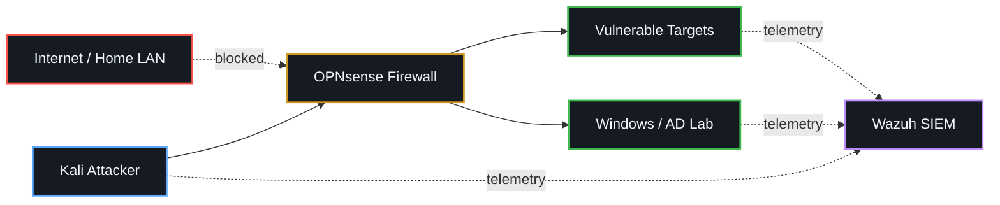
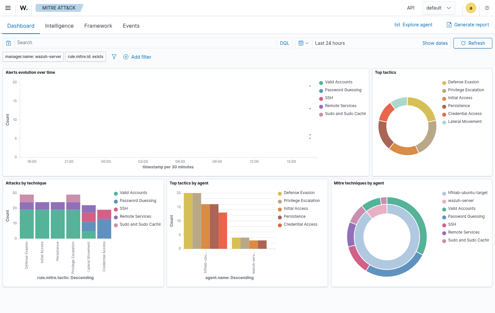
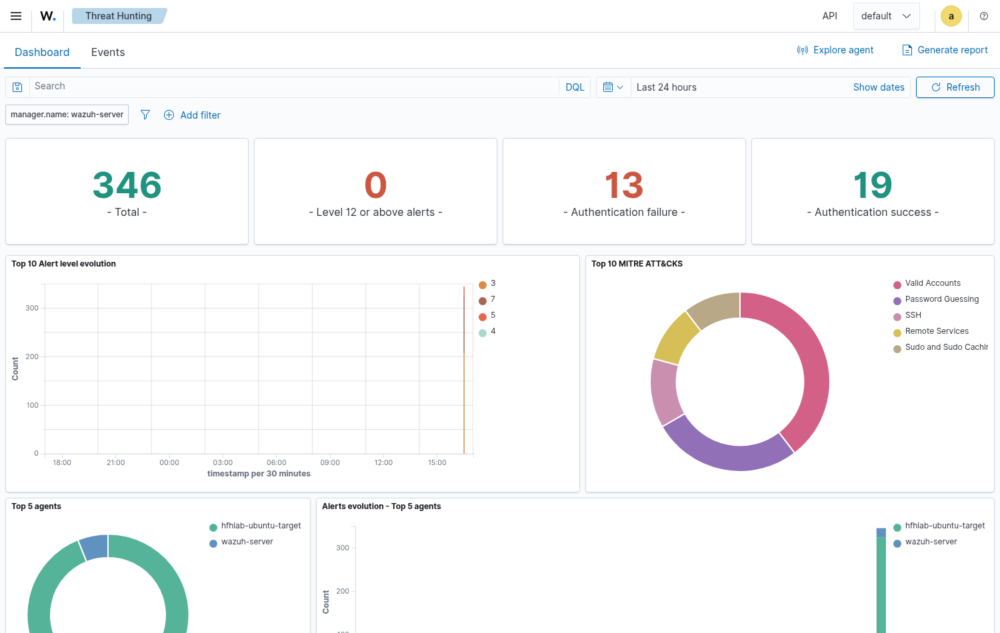
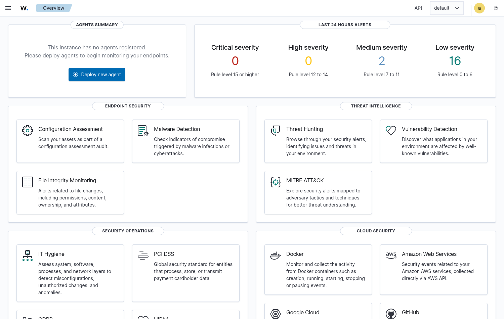

# Homelabs for Hackers

  <b>Build your own cyber range. No rack required. No prior experience assumed.</b> 
  <i>Build it&nbsp;&rarr;&nbsp;attack it&nbsp;&rarr;&nbsp;watch it light up&nbsp;&rarr;&nbsp;burn it down&nbsp;&rarr;&nbsp;repeat.</i>

  <a href="docs/00-start-here.md"><b>Start Here</b></a> &nbsp;·&nbsp;
  <a href="docs/03-virtualbox-starter-range.md">$0 Laptop Build</a> &nbsp;·&nbsp;
  <a href="docs/01-what-is-a-cyber-range.md">The Concepts</a> &nbsp;·&nbsp;
  <a href="labs/README.md">Lab Scenarios</a> &nbsp;·&nbsp;
  <a href="#contributing">Contributing</a>

---

## So what's a cyber range?

Think of it as your own personal playground for learning how to break into things and how to spot when someone's breaking into yours. You build networks, attack them, watch the alerts fire, then burn it all down and do it again. It's how the "pros" train, and there's absolutely nothing stopping you from having one at home!

This repo walks you through building a range from nothing. By the end you'll have an isolated network with attackers, vulnerable targets, and basic detection. You'll run attack scenarios, watch them light up in your logs, and reset the whole thing in minutes.

> [!WARNING]
> **Never expose vulnerable machines to the internet.** The targets in this repo are intentionally broken. They will get [owned](https://en.wikipedia.org/wiki/Owned_(slang)) within minutes if they're exposed. Keep everything on isolated networks. If you're not sure whether something is isolated, assume it isn't and fix that first. More detail in [Safety and Isolation](docs/02-safety-and-isolation.md).

<!-- 
  ctf{stage2}
  Nice work.
  
  Fragment [2/4]: "range"
  
  Next: In 2025, I gave a talk at a conference in a regional Victorian city.
  The talk was about building something with almost nothing.
  Find the conference, find the city, and combine them:
  
  echo "CONFERENCE_CITY" | md5sum
  
  Take the first 8 characters of the hash.
  Then visit: https://georgeferres.com/ctf/[first-8-chars].html
-->

## The range at a glance

A real range isn't one box, it's segments that can only talk to each other the way you allow. Here's the shape you're working towards: an attacker and your targets kept apart by a firewall, with a SIEM quietly watching everything, and no route out to the internet or your home network.

## This isn't theory, it's built

Every guide in here was walked through on real VMs. These are actual screenshots from the range, not stock images:

<table>
  <tr>
    <td width="33%" valign="top">
       
      <b>MITRE ATT&amp;CK</b> - attacks mapped to real tactics and techniques
    </td>
    <td width="33%" valign="top">
       
      <b>Live detections</b> - a brute force firing in the SIEM
    </td>
    <td width="33%" valign="top">
       
      <b>Blue-team view</b> - the Wazuh overview dashboard
    </td>
  </tr>
  <tr>
    <td width="33%" valign="top">
       
      <b>Recon</b> - scanning a target from Kali
    </td>
    <td width="33%" valign="top">
       
      <b>Targets</b> - OWASP Juice Shop, ready to break
    </td>
    <td width="33%" valign="top">
       
      <b>Segmentation</b> - OPNsense rules between segments
    </td>
  </tr>
</table>

100+ step-by-step screenshots are spread across the guides and labs.

## Your learning path

Work top to bottom, or jump to whatever you need. Each guide stands on its own.

| # | Guide | What you'll get |
|---|-------|-----------------|
| 00 | [Start Here](docs/00-start-here.md) | The lay of the land and how to use this repo |
| 01 | [What is a Cyber Range?](docs/01-what-is-a-cyber-range.md) | The concepts, in plain English |
| 02 | [Safety and Isolation](docs/02-safety-and-isolation.md) | How to keep broken machines off the internet |
| 03 | [VirtualBox Starter Range](docs/03-virtualbox-starter-range.md) | The $0 laptop build, attacker + target |
| 04 | [GNS3 Intro](docs/04-gns3-intro.md) | Real network topologies with routers and switches |
| 05 | [Proxmox Upgrade Path](docs/05-proxmox-upgrade-path.md) | Moving up to dedicated hardware |
| 06 | [Firewall with OPNsense](docs/06-firewall-opnsense.md) | Controlling traffic between segments |
| 07 | [Network Design](docs/07-network-design-and-segmentation.md) | Designing segments that make sense |
| 08 | [Attacker VM](docs/08-attacker-vm.md) | Setting up Kali or Parrot |
| 09 | [Vulnerable Targets](docs/09-vulnerable-targets.md) | Things to legally hack to bits |
| 10 | [Blue Team Basics](docs/10-blue-team-basics.md) | Logging and detection with Wazuh |
| 11 | [Snapshots and Resets](docs/11-snapshots-and-resets.md) | Getting back to a clean state in seconds |
| 13 | [Troubleshooting](docs/13-troubleshooting.md) | When it doesn't work (it happens) |

## Lab scenarios

Structured, repeatable exercises: run the attack, watch the detection, reset.

| Lab | Focus |
|-----|-------|
| [Starter Range](labs/starter-range/README.md) | Your first attacker-vs-target scenario |
| [Web App Range](labs/webapp-range/README.md) | DVWA, Juice Shop and WebGoat |
| [Windows Basics](labs/windows-basics/README.md) | Windows events, logging and recon |
| [Microsoft Sentinel](labs/microsoft-sentinel/README.md) | Cloud-based detection with KQL |

Got your own idea? There's a [template](templates/lab-recipe-template.md) ready to go.

## Quick start

<b>The absolute shortest path to a working range</b>

 

1. Install [VirtualBox](https://www.virtualbox.org/) on your laptop.
2. Follow the [VirtualBox Starter Range](docs/03-virtualbox-starter-range.md) guide to build an isolated host-only network with one attacker and one target.
3. Snapshot both VMs while they're clean (see [Snapshots and Resets](docs/11-snapshots-and-resets.md)).
4. Run your first [Starter Range lab](labs/starter-range/README.md): scan the target, watch what shows up, reset.
5. Add [detection](docs/10-blue-team-basics.md) so you can *see* the attacks, not just run them.

That's the loop. Everything else in the repo makes it bigger, more realistic, or easier to manage.

## Who's this for?

Anyone who'd rather learn by doing than read another textbook.

- **Students** who want real hands-on experience before or alongside certs
- **Career switchers** building a portfolio that proves you can do the work
- **Sysadmins** moving into the security side
- **CTF players** after a persistent lab that's always there when you need it
- **The curious** who just like pulling things apart to see how they work

If you've ever spun up a VM just to poke at it, you're in the right place.

## Contributing

The community is full of people more talented and knowledgeable than me. Please contribute your knowledge! If you've built something cool, fixed a typo, added an explanation, or written a lab scenario, I want it in here. See [CONTRIBUTING.md](CONTRIBUTING.md) for the details.

Found a bug or got stuck? Come find me:

> **Email:** georgeferres@proton.me 
> **LinkedIn:** [linkedin.com/in/georgeferres](https://www.linkedin.com/in/georgeferres/)

No question is too basic.

## Licence

**MIT.** Use it, fork it, teach with it, build on it!

  Built for tinkerers. If this helped you, a star never hurts.

