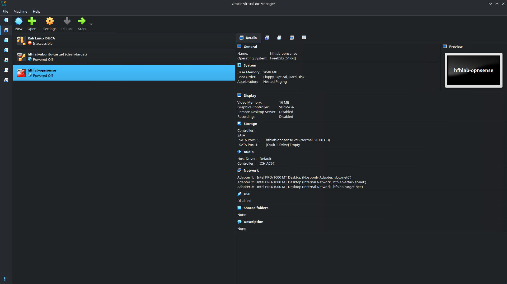
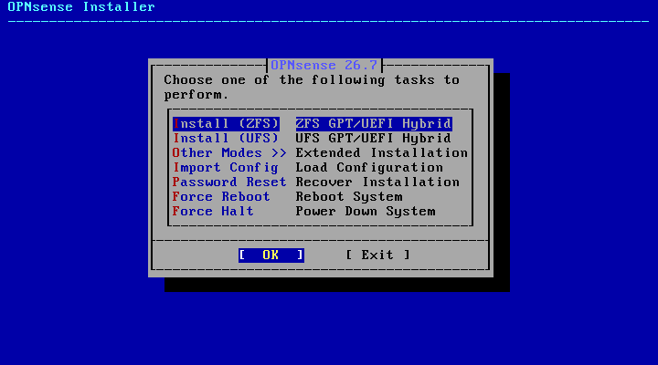
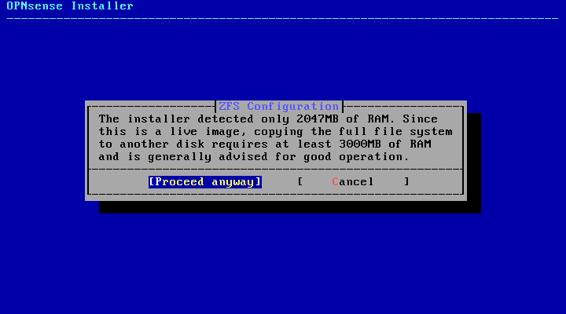
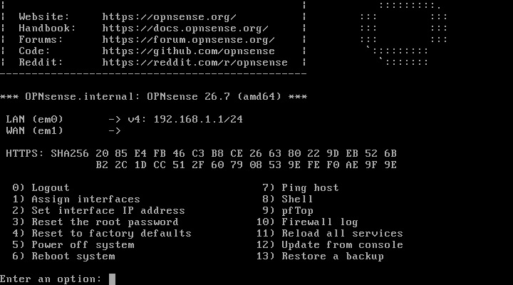
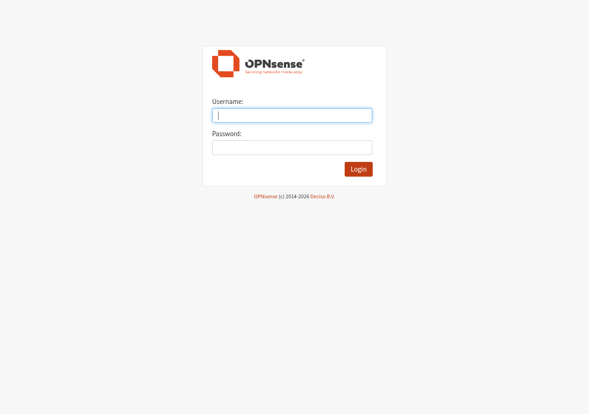
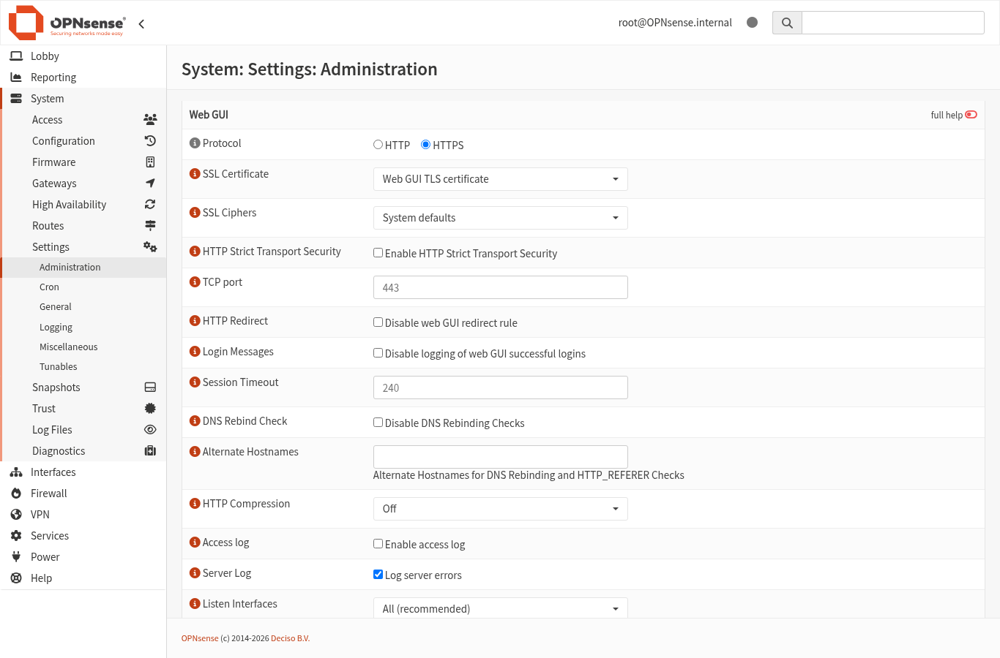
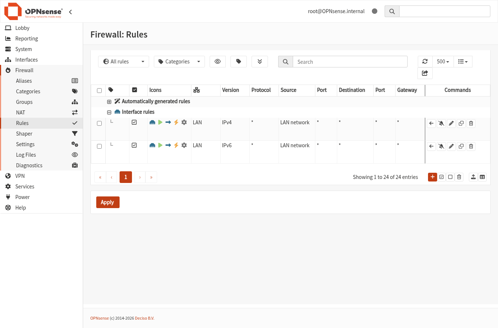
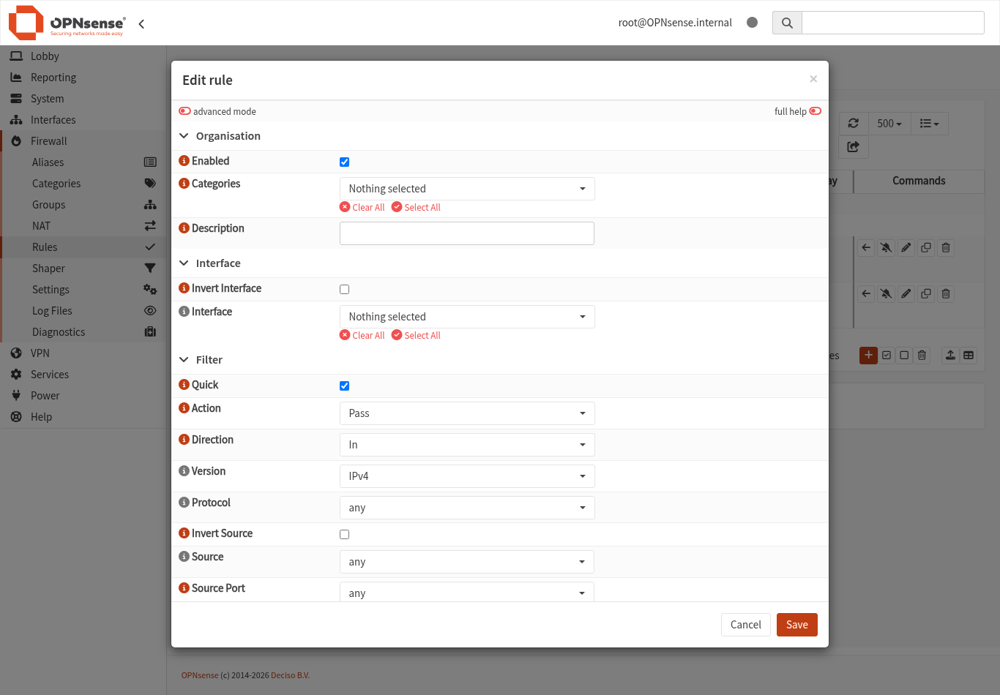
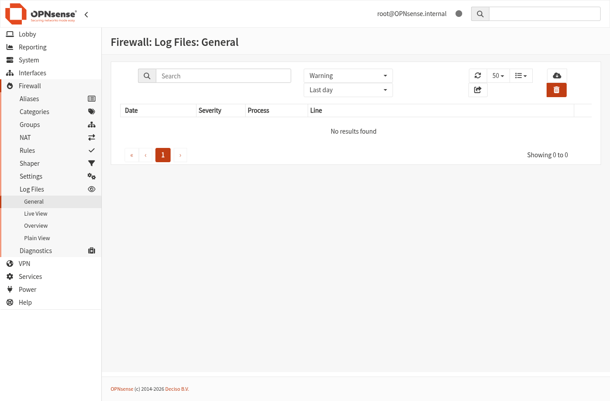

# OPNsense Firewall

A firewall in your range does three things: controls what can talk to what, logs traffic for analysis, and adds realism. Real networks have firewalls. Your range should too.

OPNsense is a solid choice. It's free, well-documented, and has enough features to keep you busy for years without being overwhelming.

## Hardware (or virtual hardware) requirements

OPNsense needs at least two network interfaces: one for WAN (outside) and one for LAN (inside). For a range, you'll want more.

### Minimum

- 2 NICs (or virtual network adapters)
- 1 GB RAM (2 GB recommended)
- 8 GB disk

### Recommended for a range

- 3 or more NICs:
  - WAN: management access (and internet if needed)
  - LAN1: attacker segment
  - LAN2: target segment
- 2 GB RAM
- 20 GB disk (more if you want extensive logging)

### In VirtualBox

Create a VM with:
- 2048 MB RAM
- 20 GB disk
- 3 network adapters:
  - Adapter 1: Host-only (for management access from your host)
  - Adapter 2: Internal Network named `attacker-net`
  - Adapter 3: Internal Network named `target-net`



*The OPNsense firewall VM with three NICs in VirtualBox Manager: Adapter 1 host-only (`vboxnet0`), Adapter 2 and 3 on internal networks for the attacker and target segments.*

### In Proxmox

Create a VM with:
- 2048 MB RAM
- 20 GB disk
- 3 network interfaces:
  - net0: `vmbr0` (management/WAN)
  - net1: `vmbr1` (attacker segment)
  - net2: `vmbr2` (target segment)

## Installation

The download is a `.bz2` compressed image (e.g. `OPNsense-26.7-dvd-amd64.iso.bz2`). Decompress it with `bunzip2` before attaching it to your VM, and check it against the published checksum first.

1. Download the OPNsense ISO from [opnsense.org/download](https://opnsense.org/download/) (the DVD image is the simplest for a VM)
2. Boot your VM from the ISO
3. Log in as `installer` with password `opnsense` (the live system's banner tells you this, and says to use the default root password)
4. Follow the installer:
   - Accept the default keymap
   - Choose a filesystem. **ZFS** is the default, but the installer warns it wants at least **3000 MB of RAM** to copy the live image. A 2 GB VM *can* finish (it just does so slowly), but give the VM **3–4 GB for the install**, or pick **UFS** which is lighter.
   - Select your disk, confirm the (destructive) write
   - Optionally set a root password now (or set it later), then **Complete Install**
   - Reboot
5. Remove the ISO and boot from disk



*The OPNsense installer task menu. ZFS is the default.*



*The ZFS install step warns when the VM has under ~3 GB RAM. Give the VM 3-4 GB for the install, or choose UFS.*

> **A note on versions.** This install flow was built on OPNsense 26.7 (amd64) in VirtualBox 7.2. The ZFS RAM warning and the LAN-only GUI behaviour described below reflect that build; your own version may differ slightly.

On first boot, OPNsense will try to configure interfaces. If it gets confused, you can manually assign them.



*The OPNsense console menu (login `root` / `opnsense`). Option 1 assigns interfaces, option 2 sets their IPs.*

## Interface configuration

After installation, you'll land at a console menu. Let's configure interfaces.

### Assign interfaces

If OPNsense didn't auto-detect correctly:

1. Select option `1` to assign interfaces
2. Skip VLAN setup for now (enter `n`)
3. Assign your interfaces:
   - WAN: the interface facing "outside" (your internet uplink, or a simulated WAN) — e.g. `em0`
   - LAN: your first internal network, the **attacker segment** (e.g. `em1`)
   - OPT1: your second internal network, the **target segment** (e.g. `em2`)

> **The web GUI lives on LAN, not WAN.** OPNsense binds the GUI to the **LAN** interface (with an anti-lockout rule) and **blocks it on WAN** by default. So you manage OPNsense from a host *on the LAN segment* (your Kali attacker at `10.10.10.x` works nicely), by browsing to the LAN gateway IP, **not** the WAN IP. See [Web interface access](#web-interface-access) below. (If you'd rather manage from your laptop on the host-only network, the simplest option is to make your host-only adapter the **LAN** interface instead.)

### Set interface IPs

Select option `2` to set interface IPs.

**For WAN:**
- Configure via DHCP if your management network has DHCP
- Or set a static IP in your management subnet

**For LAN (attacker segment):**
- IPv4 address: `10.10.10.1`
- Subnet: `24`
- Enable DHCP: yes (optional)
- DHCP range: `10.10.10.100` to `10.10.10.200`

**For OPT1 (target segment):**
- IPv4 address: `10.10.20.1`
- Subnet: `24`
- Enable DHCP: yes (optional)
- DHCP range: `10.10.20.100` to `10.10.20.200`

## Web interface access

**Important: the web GUI lives on the LAN interface, not WAN.** By default OPNsense binds the GUI to the LAN interface and protects it with an automatic "anti-lockout" rule, while **blocking GUI access from WAN**. So you cannot just point your browser at the WAN IP on a fresh install, it will be blocked.

The practical consequence: you reach the GUI from a host that sits on the **LAN** segment, by browsing to the LAN interface's IP, not the WAN IP.

To reach the GUI (two common setups):

- **From a VM on the LAN/attacker segment** (the scheme in this guide): open a browser on your Kali attacker (`10.10.10.x`) and go to `https://10.10.10.1` (the LAN gateway you set in "Set interface IPs"). This is the most faithful-to-real-life option.
- **From your laptop over host-only** (simplest for a quick look): make your **host-only adapter the LAN interface**, then set that LAN interface (console menu option `2`) to an address in your host-only range, e.g. `192.168.56.2/24` when your host is `192.168.56.1`. The console then prints the exact URL, e.g. `https://192.168.56.2`. (This is the setup the screenshot below is from.)

Then, whichever route you used:

1. Browse to that LAN URL.
2. Accept the certificate warning (it's a self-signed cert).
3. Log in: username `root`, password `opnsense`.
4. Run through the setup wizard, or skip it and configure manually. **Change the root password early**, the default is well known.

> If you genuinely need the GUI on WAN (not recommended for a vulnerable-target range), you'd have to disable the WAN anti-lockout/block behaviour and add an explicit allow rule. Prefer managing from LAN.



*The OPNsense web GUI, reached at `https://192.168.56.2` after putting the host-only (management) NIC on the LAN interface.*



*System > Settings > Administration. This is where the Web GUI protocol/port and the WAN access behaviour are controlled.*

## First ruleset: Allow what's needed, deny the rest

By default, OPNsense blocks traffic between interfaces. This is good. Now you'll create rules to allow specific traffic.



*Firewall > Rules in the OPNsense web GUI (OPNsense 26.7 serves this at `/ui/firewall/filter`). This is where you add the pass/block rules below.*

### The philosophy

- **Default deny.** If there's no rule allowing it, it's blocked.
- **Allow what's required.** Be specific about what needs to talk to what.
- **Log interesting things.** Visibility is the point.

### Creating your first rules

Go to **Firewall > Rules > LAN** (this is your attacker segment).



*The Edit rule dialog (click the **+** on the rules page). This is where you set Action (Pass/Block), Interface, Source, Destination and enable logging for each rule below.*

**Rule 1: Allow attackers to reach targets**

- Action: Pass
- Interface: LAN
- Protocol: Any (or be specific if you prefer)
- Source: LAN net
- Destination: OPT1 net
- Description: "Allow attacker to target segment"
- Log: Check this box

Click Save.

**Rule 2: Allow attackers to access the internet (optional)**

Only if you want your attacker segment to have internet for updates:

- Action: Pass
- Interface: LAN
- Protocol: Any
- Source: LAN net
- Destination: Any
- Description: "Allow attacker internet access"

Click Save.

Now go to **Firewall > Rules > OPT1** (target segment).

**Rule 3: Block targets from reaching attackers**

Actually, the default deny handles this. But you might want an explicit rule for logging:

- Action: Block
- Interface: OPT1
- Protocol: Any
- Source: OPT1 net
- Destination: LAN net
- Description: "Block targets from reaching attackers"
- Log: Check this box

**Rule 4: Block targets from reaching the internet**

Same idea:

- Action: Block
- Interface: OPT1
- Protocol: Any
- Source: OPT1 net
- Destination: Any
- Description: "Block targets from internet"
- Log: Check this box

Click **Apply Changes** at the top.

## Verification

### Test from each segment

**From your attacker VM (10.10.10.x):**

```bash
# Can you reach the firewall?
ping 10.10.10.1

# Can you reach a target?
ping 10.10.20.X

# Can you reach the internet? (if you allowed it)
ping 8.8.8.8
```

**From your target VM (10.10.20.x):**

```bash
# Can you reach the firewall?
ping 10.10.20.1

# Can you reach the attacker? (should fail)
ping 10.10.10.X

# Can you reach the internet? (should fail)
ping 8.8.8.8
```

### Confirm logs show traffic

Go to **Firewall > Log Files > Live View**.



*Firewall > Log Files in the web GUI. With logging enabled on your rules, allowed and blocked traffic shows up here.*

Generate some traffic (pings, scans) and watch the logs populate. You should see your allowed and blocked traffic with timestamps, source, destination, and action taken.

This is the start of visibility. You can see what's happening in your range.

### Backing up your firewall config
OPNsense stores its entire configuration in a single XML file. This means you can back up and restore your firewall setup independently of VM snapshots, which is handy if you want to rebuild on different hardware or share your config between ranges.

The official documentation to backup/restore the config manually as well as automatically can be found [here](https://docs.opnsense.org/manual/backups.html). Keep in mind that if you're keeping snapshot's it's not 100% nesseaery, but it is recommended.

**A note on sensitive data**
- The config file contains password hashes and potentially certificates. Treat it like you'd treat any sensitive file, so don't commit it to a public repo or leave it sitting in a shared folder.

## Optional extras

### VLANs

If you have limited physical NICs but want more segments, VLANs let you run multiple logical networks over a single interface. OPNsense supports them well.

**Interfaces > Other Types > VLAN** to create VLAN interfaces, then assign them like physical interfaces.

### Aliases

Instead of typing IP addresses repeatedly, create aliases:

**Firewall > Aliases**

- Name: `Attackers`
- Type: Network
- Content: `10.10.10.0/24`
<br><br>
- Name: `Targets`
- Type: Network
- Content: `10.10.20.0/24`

Now use `Attackers` and `Targets` in your rules instead of raw IPs. Easier to read, easier to update.

### Port-based rules

Instead of allowing all traffic, be specific:

- Allow attackers to reach targets on port 22 (SSH), 80 (HTTP), 443 (HTTPS)
- Block everything else

More realistic, and forces you to think about what services you're actually testing.

### Logging to external SIEM

OPNsense can send logs via syslog to an external system (your logging VM, a SIEM, whatever).

**System > Settings > Logging / Targets**

Add a remote syslog destination with your logging server's IP. Now your firewall logs feed into your centralised logging.

## Common issues

### "WAN interface has no IP"

- Check the network adapter is connected
- Check your management network has DHCP, or set a static IP
- In VirtualBox, ensure "Cable Connected" is checked

### "LAN interface can't ping anything"

- Verify the interface is assigned correctly
- Check the IP is configured
- Check the VM is on the correct network

### "Rules don't seem to work"

- Did you click "Apply Changes"?
- Check rule order (rules are processed top to bottom, first match wins)
- Check you're testing from the right segment

### "I locked myself out of the web interface"

Access the console (VM console or physical keyboard) and use option `2` to reconfigure interface IPs, or option `4` to reset to factory defaults.

## What's next?

With a firewall in place:

- Your range has proper segmentation
- You can log and review traffic
- You're one step closer to realistic network defence practice

For network design patterns, see [Network Design and Segmentation](07-network-design-and-segmentation.md).

For detection and logging, see [Blue Team Basics](10-blue-team-basics.md).