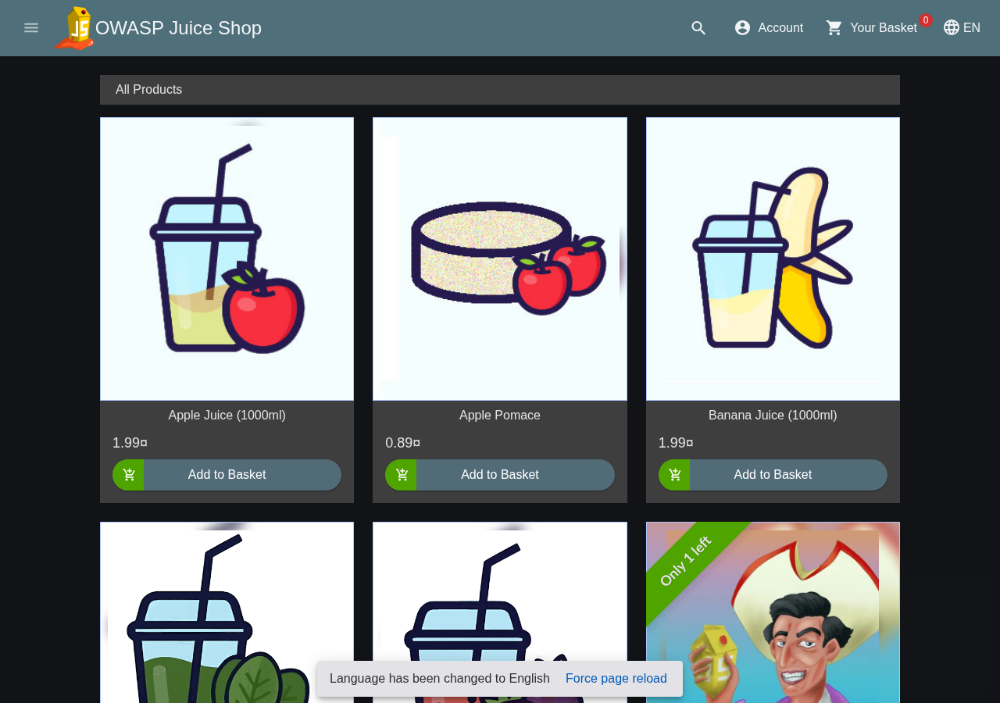
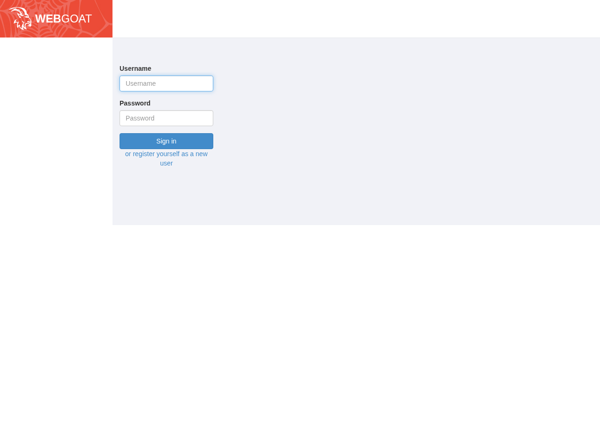

# Vulnerable Targets

These are the machines you practice breaking into. Intentionally vulnerable, legally hackable (on your own isolated network), and designed to teach specific skills.

## Rules of engagement

1. **Isolated networks only.** These targets are full of known vulnerabilities - that's the point. But on the open internet, they'd be [pwned](https://en.wikipedia.org/wiki/Leet#Owned_and_pwned) before you finish reading this sentence. Keep them on host-only or internal networks with absolutely no route out.

2. **Your network, your targets.** Only attack things you own or have explicit written permission to test. Everything in this guide is designed to be broken, but only inside your own lab.

3. **Snapshot before deploying.** Targets get messy fast once you start poking at them. Take a clean snapshot before you do anything so you can reset without the headache of rebuilding from scratch.

4. **Treat them as already compromised.** Don't put real passwords, SSH keys, or anything sensitive on target VMs. Assume that everything on these machines will be seen by someone, including future-you forgetting what credentials they left lying around.

## Safe targets list

These are well-known, intentionally vulnerable systems designed for learning.

### Web application targets

| Target | What it teaches | Format |
|--------|-----------------|--------|
| [DVWA](https://github.com/digininja/DVWA) | SQL injection, XSS, CSRF, file inclusion | PHP app (Docker or manual) |
| [OWASP Juice Shop](https://owasp.org/www-project-juice-shop/) | Modern web app vulns, OWASP Top 10 | Node.js (Docker) |
| [bWAPP](http://www.itsecgames.com/) | 100+ web vulnerabilities | PHP app |
| [WebGoat](https://owasp.org/www-project-webgoat/) | Web security lessons with hints | Java app |
| [HackTheBox Starting Point](https://www.hackthebox.com/) | Guided web and network challenges | Online (free tier) |

### Full VM targets

| Target | What it teaches | Format |
|--------|-----------------|--------|
| [Metasploitable 2](https://sourceforge.net/projects/metasploitable/) | Classic Linux vulnerabilities | VM image |
| [Metasploitable 3](https://github.com/rapid7/metasploitable3) | Windows and Linux, more modern | Vagrant build |
| [VulnHub](https://www.vulnhub.com/) | Hundreds of community VMs | VM images |
| [DVWA](https://github.com/digininja/DVWA) | Web app testing | PHP on any LAMP stack |

### Windows targets

| Target | What it teaches | Format |
|--------|-----------------|--------|
| [Windows Evaluation ISOs](https://www.microsoft.com/en-us/evalcenter/) | Real Windows, 90-day trial | ISO |
| [GOAD (Game of Active Directory)](https://github.com/Orange-Cyberdefense/GOAD) | Vulnerable Windows Active Directory lab | Build scripts (Vagrant/Ansible) |
| [DetectionLab](https://github.com/clong/DetectionLab) | Pre-wired Windows + logging/detection lab | Build scripts |
| [YOURLS](https://yourls.org/) | URL shortener with known vulns | PHP app |

For Windows, the easiest approach is grabbing evaluation ISOs from Microsoft, installing them, then intentionally weakening them (enable SMBv1, create weak passwords, install vulnerable services).

## Deploying targets quickly

### Docker (fastest for web apps)

If Docker is installed on a Linux VM:

```bash
# Juice Shop (works standalone)
docker run -d -p 3000:3000 --name juiceshop bkimminich/juice-shop

# WebGoat (served under /WebGoat, also exposes WebWolf on 9090)
docker run -d -p 8080:8080 -p 9090:9090 --name webgoat webgoat/webgoat
```

Access via browser: Juice Shop at `http://TARGET-IP:3000`, and WebGoat at `http://TARGET-IP:8080/WebGoat` (the login page is **not** at the site root).

**DVWA needs a database.** The old all-in-one `vulnerables/web-dvwa` image is years out of date. The maintained image is `ghcr.io/digininja/dvwa`, and it does **not** bundle a database, so a single `docker run` just throws a connection error. Use Docker Compose to run the app and a MariaDB together:

```yaml
# dvwa-compose.yml
name: dvwa
services:
  dvwa:
    image: ghcr.io/digininja/dvwa:latest
    depends_on: [db]
    environment:
      DB_SERVER: db
      DB_DATABASE: dvwa
      DB_USER: dvwa
      DB_PASSWORD: p@ssw0rd
    ports: ["80:80"]
  db:
    image: mariadb:10.11
    environment:
      MYSQL_ROOT_PASSWORD: dvwa-root
      MYSQL_DATABASE: dvwa
      MYSQL_USER: dvwa
      MYSQL_PASSWORD: p@ssw0rd
```

```bash
docker compose -f dvwa-compose.yml up -d
```

Then browse to `http://TARGET-IP/`, open **Setup / Reset DB**, click **Create / Reset Database** once, and log in with `admin` / `password`. New DVWA defaults the security level to *impossible*, so set it to **Low** under **DVWA Security** for the lab exercises. (A ready-to-run copy of this compose file is at [`labs/webapp-range/files/dvwa-compose.yml`](../labs/webapp-range/files/dvwa-compose.yml).)



*OWASP Juice Shop on port 3000.*



*WebGoat is served at `http://TARGET-IP:8080/WebGoat` (not the site root) and also exposes WebWolf on port 9090.*

Docker is great for quickly spinning up multiple web app targets without managing full VMs for each.

### OVA imports (full VMs)

Most VulnHub and similar targets come as OVA files to be widely compatible.

**VirtualBox:**
File > Import Appliance > Select OVA > Import

**Proxmox:**
```bash
# Extract OVA
tar -xvf target.ova

# Convert VMDK to qcow2
qemu-img convert -f vmdk -O qcow2 target.vmdk target.qcow2

# Create VM in UI, then import disk
qm importdisk VMID target.qcow2 local-lvm
```

### Manual builds

Sometimes you want to build a target from scratch:

1. Install a base OS (Ubuntu Server is easy)
2. Install the vulnerable application
3. Configure weak credentials
4. Snapshot

This teaches you how services work, which helps when you're exploiting them.

## Verification: Is the target reachable?

After deploying, verify from your attacker VM:

```bash
# Can you reach it?
ping TARGET-IP

# What services are running?
nmap -sV TARGET-IP

# For web apps, can you browse to it?
curl http://TARGET-IP:PORT
```

If Nmap shows open ports matching what you deployed, you're good.

### Common issues

**Target not pingable:**
- Check it's on the same network as your attacker
- Check the target has an IP (might need to log in and configure)
- Check no firewall is blocking (some targets have host firewalls)

**Services not showing:**
- Service might not be started. Log into the target and check.
- Service might be on a non-default port

**Can't browse web app:**
- Check port number
- Check the service is actually running
- Try curl from command line to isolate browser issues
- Try both `http` and `https`

## Reset plan

Targets get messy. You'll create files, modify configs, maybe crash services. You need a quick way to reset.

### Option 1: Snapshots

Snapshot clean state after deployment. Revert when done.

**VirtualBox:** Machine > Restore Snapshot

**Proxmox:** Snapshots tab > Rollback

### Option 2: Rebuild from script

For Docker targets, the quickest reset is in the app itself: **Setup / Reset DB > Create / Reset Database**. To rebuild the containers from scratch (clearing the database volume too):
```bash
# DVWA (compose from above): -v also removes the database volume
docker compose -f dvwa-compose.yml down -v && docker compose -f dvwa-compose.yml up -d

# Juice Shop / WebGoat (stateless enough to just recreate)
docker rm -f juiceshop && docker run -d -p 3000:3000 --name juiceshop bkimminich/juice-shop
```
Note: for DVWA, `docker rm` of just the app container does **not** reset the database, the data lives in the DB container's volume, so use `down -v` (or the in-app Create/Reset DB) to get a truly clean state.

For VMs, keep the OVA and re-import. Or maintain a clone that stays clean.

### Option 3: Linked clones

VirtualBox and Proxmox both support linked clones from a snapshot. Deploy a clean target, snapshot it, create linked clones. Attack the clone, delete it, create a new one. The base stays clean.

## Target ideas for specific skills

| Skill to practice | Target suggestion |
|-------------------|-------------------|
| Network scanning | Any VM with multiple services |
| Web app testing | DVWA, Juice Shop |
| SQL injection | DVWA, SQLi-labs |
| Password attacks | Any with SSH/RDP and weak creds |
| Privilege escalation | VulnHub boxes designed for it |
| Active Directory | Build your own AD lab (separate guide needed) |
| Exploit development | Metasploitable, specific CVE targets |

## Don't hoard targets

It's tempting to download 50 VulnHub VMs for later. Try to resist the dark side. Deploy one target, learn from it thoroughly, then move on. A focused lab beats a cluttered one!

You can always download more when you need them. (Do as I say, not as I do).

## What's next?

With targets deployed:

- [Start attacking from your attacker VM](08-attacker-vm.md)
- [Set up detection to watch your attacks](10-blue-team-basics.md)
- [Run structured lab scenarios](../labs/README.md)