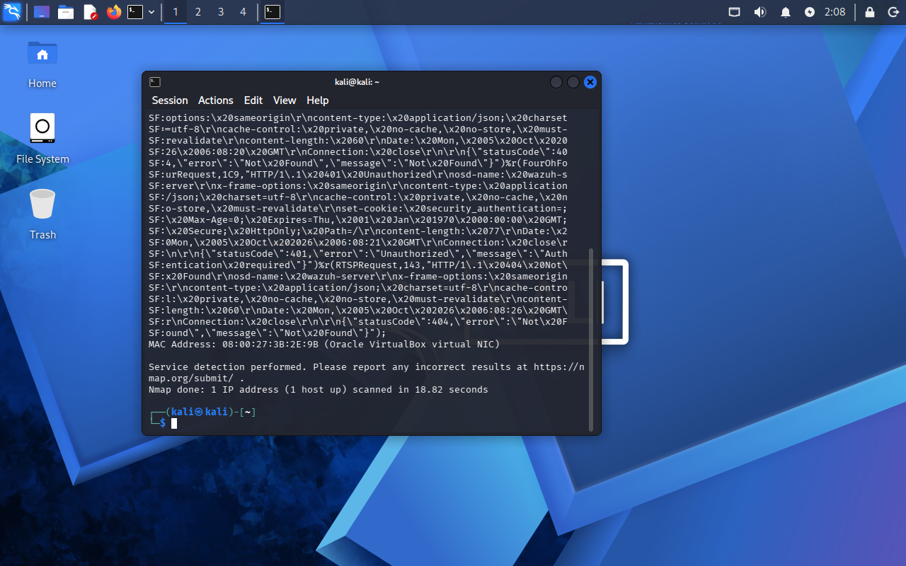

# Starter Range Lab

**Difficulty:** 🟢 Beginner

**Time:** 30 minutes

**Focus:** Your first scan, first firewall rule, first log entry. The fundamentals.

## Goal

Run a port scan against a target, observe what happens on the network, and see the activity in your firewall logs. This is the "hello world" of range work.

## Prerequisites

- [ ] Attacker VM (Kali or Parrot) with `nmap` installed
- [ ] Target VM (Ubuntu or any Linux with SSH enabled)
- [ ] Both VMs on the same isolated network
- [ ] (Optional) OPNsense firewall between them with logging enabled
- [ ] (Optional) Logging/SIEM receiving firewall logs

If you don't have the firewall yet, that's fine. You can still do the scan and observe from the target's perspective.

## Topology

### Basic (no firewall)

```
┌──────────────┐                    ┌──────────────┐
│    Kali      │◄──────────────────►│   Ubuntu     │
│  Attacker    │   Host-only Net    │   Target     │
│ 192.168.56.10│   192.168.56.0/24  │192.168.56.20 │
└──────────────┘                    └──────────────┘
```

### With firewall

```
┌──────────────┐      ┌──────────────┐      ┌──────────────┐
│    Kali      │      │   OPNsense   │      │   Ubuntu     │
│  Attacker    │◄────►│   Firewall   │◄────►│   Target     │
│  10.10.10.10 │      │  .1 on each  │      │  10.10.20.20 │
└──────────────┘      └──────────────┘      └──────────────┘
   Attacker Net          Firewall             Target Net
   10.10.10.0/24                            10.10.20.0/24
```

## Build steps

### Step 1: Verify network connectivity

From your Kali VM:

```bash
ping -c 3 TARGET-IP
```

You should see replies. If not, check [Troubleshooting](../../docs/13-troubleshooting.md).

### Step 2: Verify target has services running

Make sure your target has at least one service to discover. SSH is easiest:

On the target:
```bash
sudo systemctl status ssh
```

If SSH isn't running:
```bash
sudo apt install openssh-server -y
sudo systemctl start ssh
sudo systemctl enable ssh
```

### Step 3: Snapshot both VMs

Before we start, snapshot your clean state.

**VirtualBox:** Machine > Take Snapshot

Name: `lab01-ready`

## Run the scenario

### Attack step 1: Basic host discovery

From Kali, let's see if the target is up:

```bash
nmap -sn TARGET-IP
```

The `-sn` flag does a ping scan (no port scan). It tells you if the host is alive.

**What you should see:**
```
Nmap scan report for TARGET-IP
Host is up (0.00050s latency).
```

### Attack step 2: Port scan

Now let's see what services are running:

```bash
nmap -sV TARGET-IP
```

The `-sV` flag probes open ports to determine service versions.

**What you should see:**
```
PORT   STATE SERVICE VERSION
22/tcp open  ssh     OpenSSH 8.9p1 Ubuntu 3ubuntu0.1
```



*`nmap -sV` run from the Kali attacker against a target on the isolated range network.*

### Attack step 3: More aggressive scan

Let's get more information:

```bash
nmap -A TARGET-IP
```

The `-A` flag enables OS detection, version detection, script scanning, and traceroute.

**What you should see:** Detailed output including OS guess, service versions, and potentially script output.

### Attack step 4: Full port scan

By default, Nmap only scans the top 1000 ports. Let's scan all of them:

```bash
nmap -p- TARGET-IP
```

This takes longer but finds services on non-standard ports.

### Success criteria

You've successfully:
- Confirmed the target is reachable
- Identified open ports
- Determined what services are running

## Detection goals

### From the target's perspective

While running scans, check what the target sees:

On the target VM:
```bash
# See what's LISTENING (note: this shows your own services, not the scan itself)
ss -tuln

# The most reliable way to actually see a scan hit the box: capture packets
sudo tcpdump -ni any "src 192.168.56.10 and (tcp[tcpflags] & tcp-syn != 0)"

# Service logs only capture connections that reach a running service
sudo tail -f /var/log/auth.log
```

**What you'll actually see (and what you won't).** This trips a lot of people up, so be precise about it:

- `ss -tuln` lists *listening* sockets (your SSH server on `:22`). It does **not** show the scan's incoming connections, which are far too short-lived to catch this way.
- A plain port scan is **not** an authentication attempt. Scanning SSH does not create a "failed login" event. The most you'll see in `auth.log` is a single line like `sshd[...]: Connection closed by 192.168.56.10 port ...` when the scan opens and drops a TCP connection to port 22. Scans of **closed** ports (where nothing is listening) produce **nothing** in `auth.log` at all.
- To genuinely *see* a scan, use a packet capture (the `tcpdump` above) or your firewall logs. This is exactly why the firewall and SIEM parts of the range matter: the host's own service logs are nearly blind to reconnaissance.

(On Ubuntu 24.04.5, a `-sT`/`-sV` scan of port 22 produces a single `Connection closed by` line and no authentication event; closed ports log nothing.)

### From the firewall's perspective (if you have one)

In OPNsense: Firewall > Log Files > Live View

| What to find | Where to look | What it indicates |
|--------------|---------------|-------------------|
| Many connections from one IP | Firewall logs | Port scanning activity |
| Connections to many ports | Firewall logs | Enumeration |
| Short-lived connections | Connection logs | Scan, not real usage |

### From your SIEM (if configured)

If you've got Wazuh or similar receiving logs:

- Search for the attacker IP
- Look for alerts mentioning "scan" or "reconnaissance"
- Check for high volume of connections in a short time

## Reset steps

1. No permanent changes were made, but revert snapshots if you want a clean slate
2. If you created files or notes on either VM, clean them up

```bash
# On Kali, if you saved scan results
rm *.nmap *.xml 2>/dev/null
```

## Debrief questions

1. **What services did you find?** Were there any surprises?

2. **How long did different scan types take?** Why does `-p-` take so long?

3. **What did the scans look like from the target's perspective?** Could a defender notice this?

4. **If you had a firewall, what rules could limit this reconnaissance?** (Rate limiting? Blocking specific patterns?)

5. **What's the difference between a scan that tries to be stealthy and one that doesn't?** Research Nmap timing options (`-T0` through `-T5`).

## Portfolio notes

For your portfolio, capture:

- [ ] Screenshot of Nmap output showing discovered services
- [ ] Screenshot of target-side logs showing the scan
- [ ] Screenshot of firewall logs (if applicable)
- [ ] Brief write-up: "I scanned a target, found X services, and observed the activity in logs. Here's what I learned about how scans appear to defenders."

## Further reading

- [Nmap Reference Guide](https://nmap.org/book/man.html)
- [Port Scanning Techniques](https://nmap.org/book/man-port-scanning-techniques.html)
- [Nmap Scripting Engine (NSE)](https://nmap.org/book/nse.html)

## Next labs

- [Web App Range](../webapp-range/README.md) - Attack a web application
- [Windows Basics](../windows-basics/README.md) - Windows-specific techniques